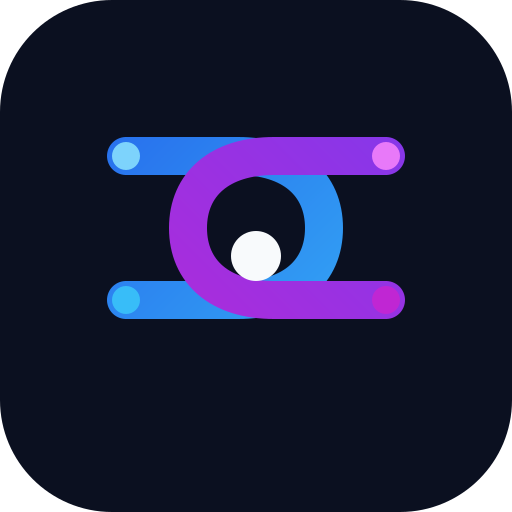
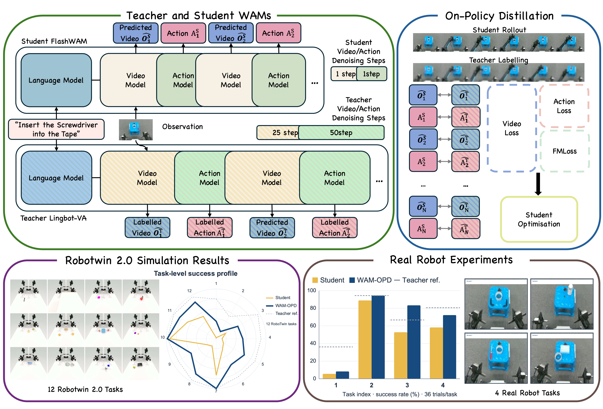
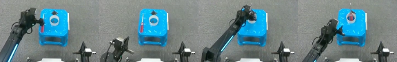
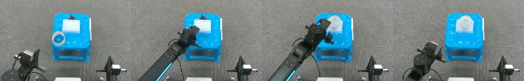

<p align="center">
  
</p>

<h1 align="center">WAM-OPD</h1>

<h3 align="center">Joint Video-Action Supervision for World Action Model<br>Post-Training with On-Policy Distillation</h3>

<p align="center">
  Learn from a stronger Teacher on Student rollout histories.<br>
  <strong>Paired video and action targets. One-step Student deployment.</strong>
</p>

<p align="center">
  <a href="https://arxiv.org/abs/2608.22364"></a>
  <a href="https://github.com/UCL-ERL/WAM-OPD/actions/workflows/ci.yml"></a>
  <a href="LICENSE"></a>
</p>

<p align="center">
  <a href="https://arxiv.org/abs/2608.22364"><strong>Paper</strong></a> ·
  <a href="https://arxiv.org/pdf/2608.22364"><strong>PDF</strong></a> ·
  <a href="#results">Results</a> ·
  <a href="#installation">Installation</a> ·
  <a href="docs/README.md">Documentation</a> ·
  <a href="#citation-and-license">Citation</a>
</p>

<p align="center">
  <a href="https://arxiv.org/abs/2608.22364v2">
    
  </a>
</p>

**WAM-OPD** post-trains a World Action Model with Teacher supervision on the
histories collected by the Student. The Teacher supplies paired video and
action targets; the Student learns from both while keeping its own
video-to-action computation. At deployment, the updated Flash-WAM Student
still uses **one video step and one action step**.

## Results

Reported results from [arXiv v2](https://arxiv.org/abs/2608.22364v2), comparing
the Student before and after WAM-OPD:

| Evaluation | Tasks | Trials per task and policy | Student | WAM-OPD | Gain |
| :--- | :---: | :---: | ---: | ---: | ---: |
| **RoboTwin 2.0** | 12 | 60 | 33.8% | **65.7%** | **+31.9 pp** |
| **Real robot** | 4 | 36 | 51.4% | **64.6%** | **+13.2 pp** |

Success rates are averaged across tasks. Gains are absolute percentage-point
changes. Simulation comparisons use matched rollout seeds and noise banks.
See the paper for per-task results and Teacher references.

- **Video and action supervision:** with Student histories held fixed, joint
  supervision achieves the highest observed success on all three ablation
  tasks; either modality alone also improves performance.
- **History source:** the comparison with Teacher-generated histories is
  task-dependent; neither source consistently outperforms the other.
- **Deployment budget:** WAM-OPD keeps the Student's one-step video and
  one-step action generation.

### Real-robot rollouts

Representative execution frames from the paper's four-task evaluation:

**Insert Screw Driver Tape**

<p align="center">
  
</p>

**Put Tape Platform**

<p align="center">
  
</p>

## News

- **2026-10-01** — [Paper v2](https://arxiv.org/abs/2608.22364v2): joint
  video-action supervision, simulation and real-robot evaluation, and controlled
  ablations.
- **2026-08-23** — [First arXiv release](https://arxiv.org/abs/2608.22364v1).

## Pipeline at a glance

| Stage | What happens |
| :--- | :--- |
| **1. Student rollout** | The Student acts in the environment and records observation-action histories. |
| **2. Teacher labeling** | A frozen Teacher predicts paired video and action targets on those histories. |
| **3. Student update** | The Student learns from the targets through its own video-to-action computation. |
| **4. Evaluation** | Compare the released and updated Student with matched simulation seeds and noise banks. |

The implementation uses **Flash-WAM as the Student**, **LingBot-VA as the
Teacher**, and **JointLoRA adapters** for post-training. The Teacher supplies
labels during training; the Student controls the environment. See the
[paper's Method section](https://arxiv.org/html/2608.22364v2#S3) and the
[pipeline contract](QUALIFIED_SUCCESS_PATH_PIPELINE_V1.md) for details.

## Release status

The public repository provides training orchestration, model adapters,
task contracts, and evaluation tools. Model weights, datasets and simulator
assets are external dependencies.

CPU verification and an isolated GPU smoke test have passed. Full
fresh-machine benchmark reproduction remains **uncertified**; the reported
paper results are distinct from the repository's release checks. Start with
[Reproducibility](docs/REPRODUCIBILITY.md) for verified scope and setup details.

## Installation

Use an independent WAM-OPD Python environment. Its direct model/simulator
sources live under `third_party/lingbot-va` and
`third_party/RoboTwin-lingbot-native`; no surrounding research workspace is
required by the default installation layout.

```bash
git clone https://github.com/UCL-ERL/WAM-OPD.git
cd WAM-OPD

# Lightweight development/tests (Python 3.10–3.12; no model downloads).
python3.11 -m venv .venv
source .venv/bin/activate
python -m pip install '.[dev]'
make test

# Environment and source-tree check (does not load model weights).
wam-opd doctor
```

For GPU experiments, prepare a WAM-OPD environment with CUDA, LingBot-VA and
RoboTwin dependencies. The helper below downloads the pinned upstream source
trees and applies the versioned WAM-OPD compatibility patch. Python/CUDA
packages, model weights and simulator assets are installed separately.
See [Reproducibility](docs/REPRODUCIBILITY.md) for the remaining release gates.

```bash
bash scripts/bootstrap_dependencies.sh
cp .env.example .env
# Set WAM_OPD_RUNTIME_ROOT to this checkout, WAM_OPD_PYTHON_BIN to its
# .venv/bin/python, and configure the model and artifact roots.
set -a
source .env
set +a
```

The full pipeline needs these external inputs:

1. released `FlashWAM-RoboTwin` Student;
2. the official `lingbot-va-posttrain-robotwin` Teacher Transformer;
3. RoboTwin native source and assets, with LingBot-VA source;
4. a qualified task decision and outcome-free episode metadata;
5. writable artifact and scratch roots outside this repository.

The current formal validators require artifact output and qualification paths
under `/ssd/data`; arbitrary paths shown in `.env.example` are placeholders,
not a promise that every storage layout is supported.

## Verify the repository

These checks do not load models or require GPUs:

```bash
make compile
make test
```

Equivalent commands are:

```bash
python3 -m compileall -q experiments tests
python3 -m pytest -q \
  tests/test_opd_task_specs.py \
  experiments/test_qualified_success_path_pipeline.py \
  experiments/test_scaled_qualified_success_path_pipeline.py \
  experiments/test_stage_h_task_progress.py
```

Runtime tests require the pinned RoboTwin/LingBot environment:

```bash
make test-runtime

# On a prepared GPU host:
wam-opd doctor --require-gpu --require-models
```

## Run the qualified pipeline

Generate a task manifest with the binder. Generated configs belong under
`configs/generated/` and are intentionally untracked.

```bash
python3 -m experiments.bind_scaled_qualified_success_path_task \
  --task place_a2b_left \
  --metadata-source /path/to/accepted_episode_metadata.json \
  --qualification-decision /path/to/decision.json \
  --gpu-ids 0,1,2,3 \
  --noise-banks 31001 31002 32001 32002 \
  --train-count 24 \
  --calibration-count 12 \
  --screening-count 4 \
  --heldout-count 6 \
  --collection-workers-per-gpu 1 \
  --run-date YYYYMMDD

python3 -m experiments.run_scaled_qualified_success_path_pipeline validate \
  --manifest configs/generated/<task>_scaled_qualified_pipeline_v1_<date>.json

# Starts real GPU collection probes; this is NOT a dry-run.
python3 -m experiments.run_scaled_qualified_success_path_pipeline canary \
  --manifest configs/generated/<task>_scaled_qualified_pipeline_v1_<date>.json \
  --workers-per-gpu 1

python3 -m experiments.run_scaled_qualified_success_path_pipeline run \
  --manifest configs/generated/<task>_scaled_qualified_pipeline_v1_<date>.json
```

Use the configured runtime interpreter for all GPU commands above. The scaled
controller requires a canary decision and does not implement `--dry-run`.
The older shell wrapper is for the fixed 8-train/4-calibration pipeline, not
the scaled manifest above. This example ends with formal12 (6 held-out seeds
× 2 noise banks), **not** a complete paper paired60 evaluation.

The controller is fail-closed: it derives state from stage receipts, refuses
partial or ambiguous output, and never deletes or overwrites an existing
artifact root.

## Evaluation and artifacts

Formal evaluation uses exact-paired Released/Adapted units. Keep the following
outside the repository and bind them from a manifest:

- model and adapter checkpoints;
- trajectory and Teacher-label artifacts;
- frozen formal/extension protocols and noise banks;
- per-unit episode outputs and videos;
- logs, summaries, and recovery receipts.

See [`docs/ARTIFACT_POLICY.md`](docs/ARTIFACT_POLICY.md) before moving an
artifact or reusing an output root.

The stable task-generic module name is:

```bash
python3 -m experiments.run_paired_multinoise --help
```

It delegates to the existing paired evaluator and does not introduce a second
evaluation implementation.

## Real-robot safety

Start with [`docs/deployment/REAL_ROBOT_DEPLOYMENT.md`](docs/deployment/REAL_ROBOT_DEPLOYMENT.md).
This repository does not contain a verified production robot SDK adapter,
calibration layer, collision supervisor, watchdog, or E-stop integration.
Simulation success is not evidence of hardware safety. The required progression
is:

```text
offline two-chunk parity
→ WebSocket loopback
→ motors-disabled shadow mode
→ human-authorized low-speed one-chunk test
→ guarded closed-loop trials
```

<details>
<summary><strong>Repository structure and research-server synchronization</strong></summary>

## Project structure

See the [documentation map](docs/README.md) and
[`docs/REPOSITORY_LAYOUT.md`](docs/REPOSITORY_LAYOUT.md) for ownership and
compatibility rules. The short version is:

| Path | Responsibility |
| --- | --- |
| `experiments/` | Stable Python entry points, model adapters, task contracts, and focused tests. Existing module paths are compatibility-sensitive. |
| `scripts/` | Thin shell entry points and dependency bootstrap helpers. |
| `configs/` | Schemas and documentation for generated configs; generated configs are ignored. |
| `docs/method/` | Method decisions and protocol contracts. |
| `docs/deployment/` | Real-robot safety and deployment gates. |
| `repro/` | External dependency pins and source allowlists. |
| `tests/` | Repository-level contract tests. |

Files named `prototype_*`, stage diagnostics, and historical experiment
helpers remain at their established paths when external workflows may import
them. They are not default pipeline entry points; the navigation documents
identify their intended status instead of deleting them speculatively.

### Repository status and source of truth

The public Git repository is the portable, reviewable code surface. The
experiments that run on the research server use a larger working snapshot with
additional task-specific and diagnostic scripts. The synchronization boundary
and verification procedure are documented in
[`docs/SERVER_SOURCE_SYNC.md`](docs/SERVER_SOURCE_SYNC.md).

When a public file and the server snapshot differ, do not silently assume that
the local file is authoritative. Record the server file hash, decide whether it
is a canonical runtime surface or an internal diagnostic, then synchronize the
smallest compatible change. This keeps the repository reproducible without
publishing checkpoints or server-only paths.

</details>

## Contributing

Use the existing module paths and contracts unless a migration is explicitly
planned. Before a structural change:

1. read the relevant method and deployment contract;
2. run the baseline `make test` checks;
3. make the smallest compatible change;
4. run focused tests, then the repository checks;
5. document any server-source synchronization or artifact-format change.

The current contributor list is in [`CONTRIBUTORS.md`](CONTRIBUTORS.md).

## Citation and license

If WAM-OPD is useful for your research, please cite the
[paper](https://arxiv.org/abs/2608.22364). The entry below is also available in
[`paper.bib`](paper.bib); [`CITATION.cff`](CITATION.cff) supplies GitHub's
**Cite this repository** metadata.

```bibtex
@misc{yang2026wamopdjointvideoactionsupervision,
      title={WAM-OPD: Joint Video-Action Supervision for World Action Model Post-Training with On-Policy Distillation},
      author={Liuhaichen Yang and Zhengyang Zhong and Hanshang Zhu and Ningwei Bai and Qichen Yin and Zhi Han and Jiarui Qin and Zhuang Jiang and Chenchao Sheng and Hanbo Ma and Junkai Liu and Junkai Sun and Dongcheng Lyu and Bo Liu and Yi Dong and Zezhi Tang},
      year={2026},
      eprint={2608.22364},
      archivePrefix={arXiv},
      primaryClass={cs.AI},
      url={https://arxiv.org/abs/2608.22364},
}
```

Repository code is licensed under [Apache-2.0](LICENSE). The paper and its
figures are distributed under [CC BY 4.0](https://creativecommons.org/licenses/by/4.0/).
External models, datasets, simulators, and separately distributed dependencies
retain their own licenses.

## Acknowledgments

WAM-OPD builds on [LingBot-VA](https://github.com/robbyant/lingbot-va),
[Flash-WAM](https://arxiv.org/abs/2606.05254) and
[RoboTwin 2.0](https://github.com/RoboTwin-Platform/RoboTwin).
